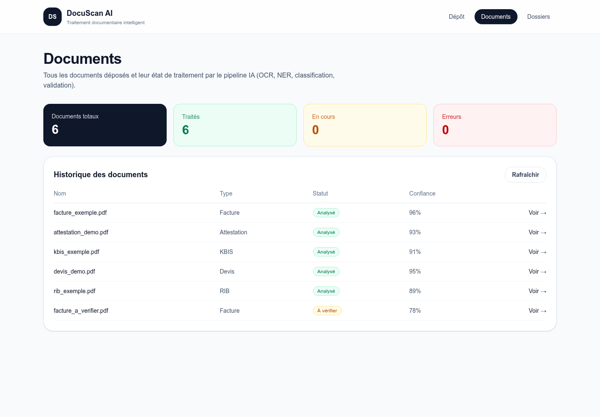
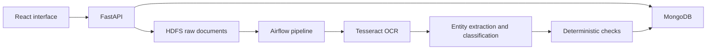

[Français](docs/CASE_STUDY.fr.md) · [Philippe Le Goff](https://github.com/PhilLeGoff) · [Portfolio](https://www.webbyphil.net/)

# DocuScan AI

A hackathon document-processing platform that connects document upload, OCR, entity extraction, classification and deterministic validation with a business-facing interface.

**React · FastAPI · MongoDB · Tesseract · spaCy · Airflow · HDFS · Docker**

*Screenshot context: real application interface rendered locally with synthetic fixtures. Displayed AI results are illustrative fixtures, not measured model output.*

## What it does

- Upload documents and follow their processing state.
- Extract text and fields from invoices and administrative documents.
- Combine NLP/classification components with explicit validation rules.
- Expose document results, anomalies and business case workflows through an API and React interface.

## Architecture

## My contribution

I contributed to this seven-person hackathon project. This personal repository preserves the original team history and presents the complete product together rather than suggesting that the frontend alone is the project. The source shows how document ingestion, processing stages and reviewable results connect; team contributions remain credited.

## Running and inspecting the project

The repository includes `frontend/`, `backend/`, `ia/`, `airflow/` and `docker/`. Use Docker Compose from `docker/docker-compose.yml` for the infrastructure; review local ports and model requirements first. For the interface: `cd frontend`, `npm ci`, `npm run dev`. See [original technical documentation](docs/README.original.md) for the processing modules and service setup.

## Current state and limitations

Academic hackathon prototype. OCR quality depends on the input, and validation rules are not a legal compliance guarantee. Some model paths are optional and require downloads. No production certification, customer adoption or independently measured accuracy is claimed. Bundled historical sample material is not a production dataset.

## Credits

Derived from [the original group repository](https://github.com/PhilLeGoff/hackaton-groupe-12). Seven-person academic hackathon; original Git authors and technical documentation are preserved. See [credits](docs/CREDITS.md). No new license is imposed on existing team code.
