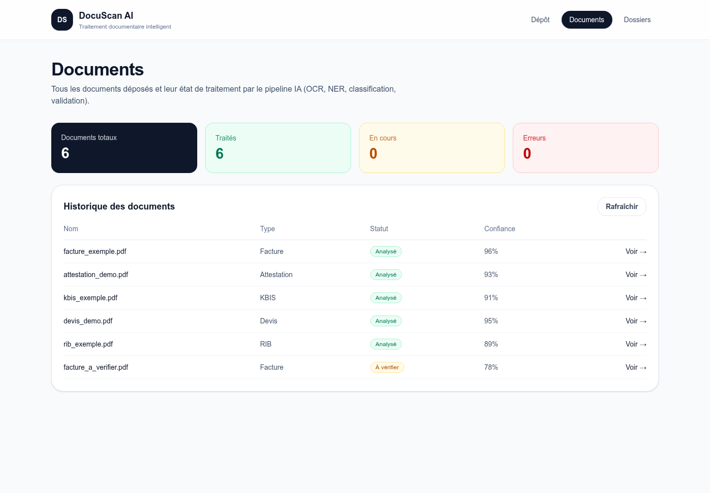
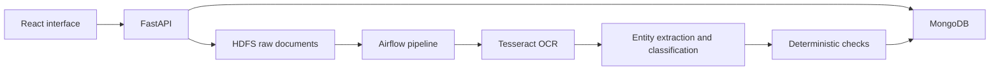

# DocuScan AI

**Des documents administratifs aux données métier vérifiables.**

[English](../README.md) · [Portfolio](https://www.webbyphil.net/)

Une plateforme de hackathon qui relie le dépôt de documents, l’OCR, l’extraction d’entités, la classification et les validations déterministes à une interface métier.

**React · FastAPI · MongoDB · Tesseract · spaCy · Airflow · HDFS · Docker**

*Interface réelle exécutée localement avec des données fictives. Les résultats IA affichés sont illustratifs et ne constituent pas une mesure des modèles.*

## Fonctionnalités

- Dépôt des documents et suivi du traitement.
- Extraction de texte et de champs à partir de factures et documents administratifs.
- Combinaison de composants NLP/classification et de règles de validation explicites.
- Consultation des résultats, anomalies et dossiers métier via une API et une interface React.

## Architecture

## Ma contribution

J’ai participé à ce hackathon réalisé à sept. Ce dépôt personnel conserve l’historique de l’équipe et présente le produit complet dans un même dépôt. Il rend lisible le lien entre ingestion, étapes de traitement et résultats vérifiables, en conservant les contributions de l’équipe.

## Installation et consultation

Le dépôt regroupe `frontend/`, `backend/`, `ia/`, `airflow/` et `docker/`. L’infrastructure utilise `docker/docker-compose.yml` ; vérifiez les ports locaux et les modèles requis. Pour l’interface : `cd frontend`, `npm ci`, `npm run dev`. La [documentation technique d’origine](README.original.md) décrit les modules et services.

## État actuel et limites

Prototype académique de hackathon. La qualité de l’OCR dépend du document ; les règles ne garantissent pas une conformité juridique. Certains modèles sont facultatifs et nécessitent un téléchargement. Aucune certification de production, adoption commerciale ou précision mesurée indépendamment n’est revendiquée. Les exemples historiques ne constituent pas un jeu de données de production.

Les crédits et références d’origine sont conservés dans le [README principal](../README.md#credits).
